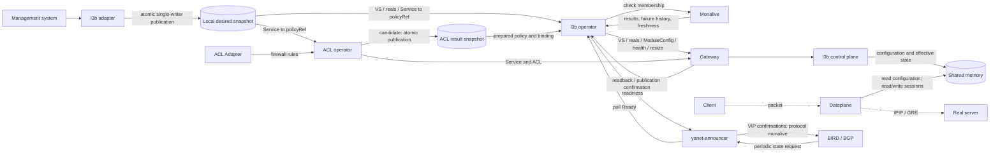
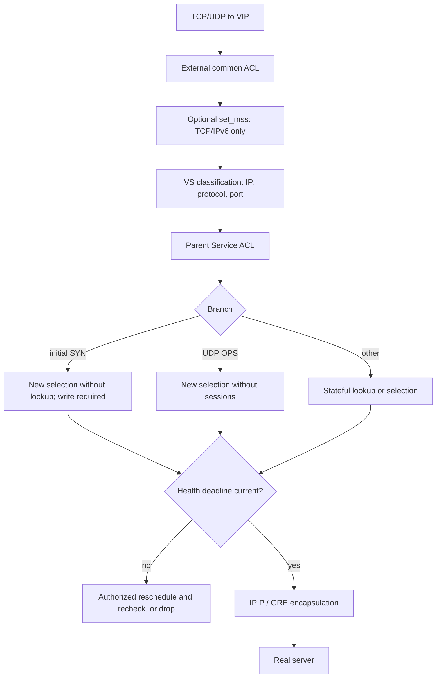
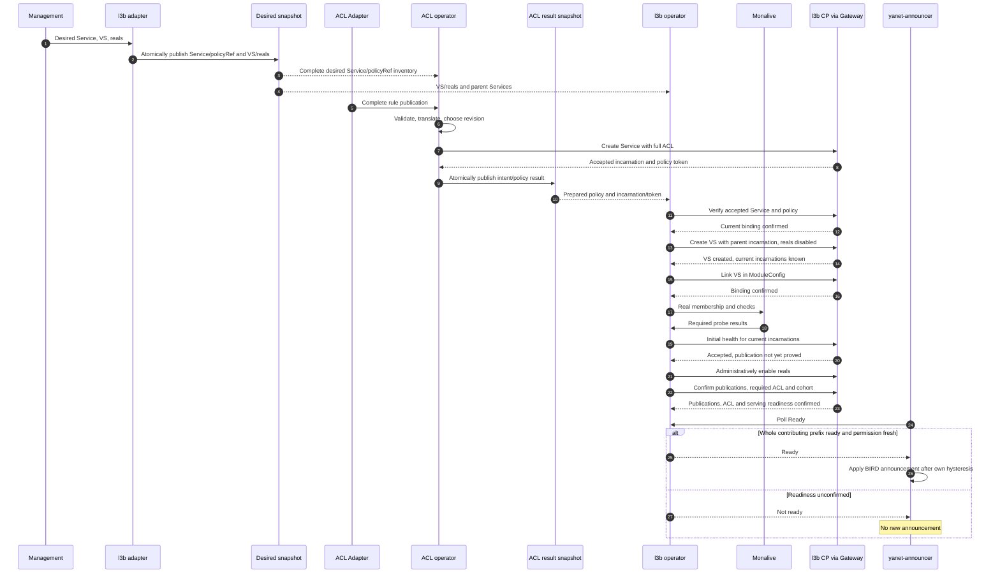
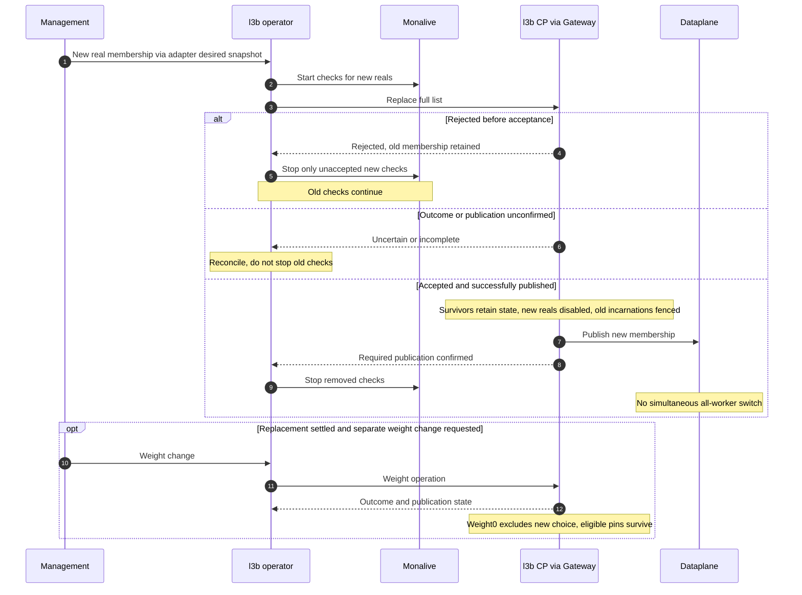
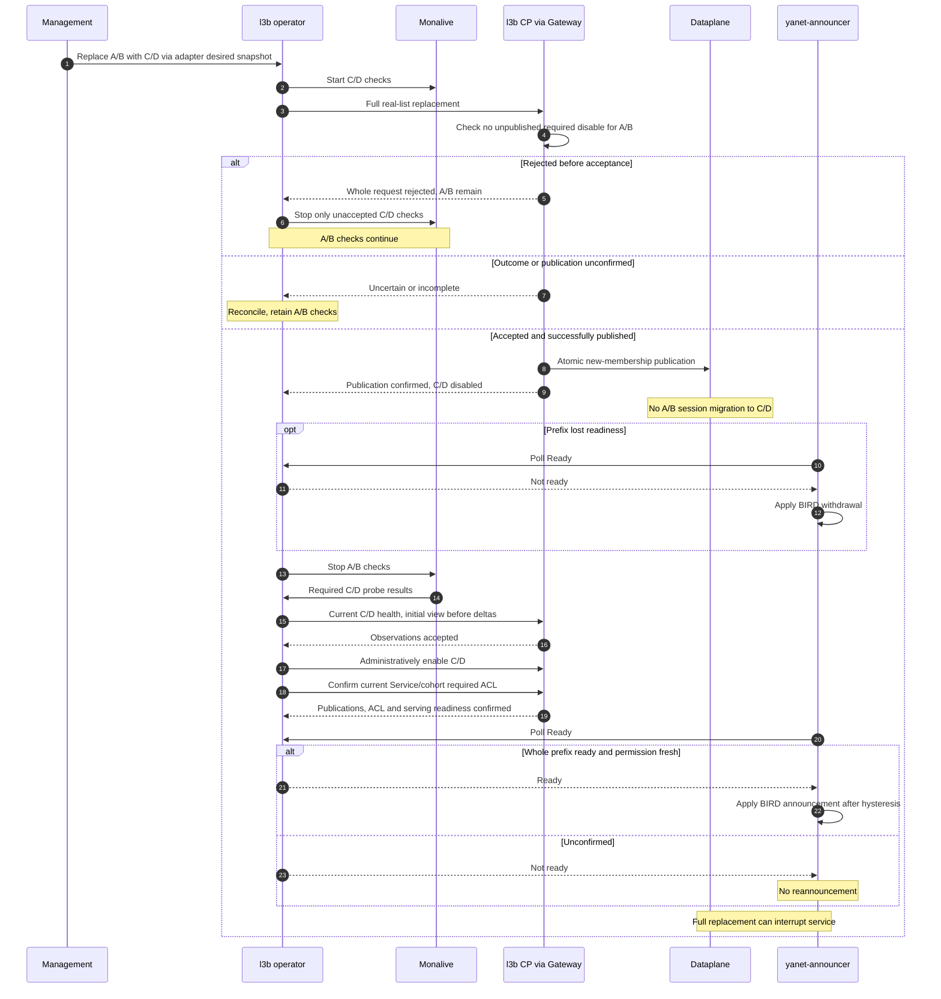
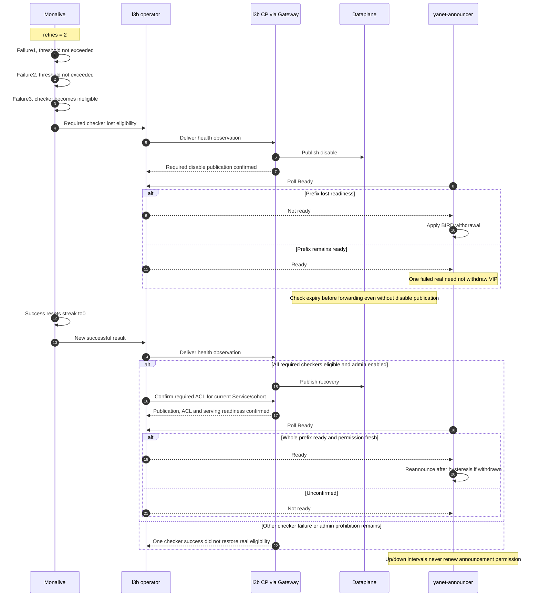

# l3b in YANET2: operator overview

This is target behavior, not completed implementation or conformance evidence.
Comparisons refer to Linux v6.12 IPVS and the pinned historical YANET1 revision
in the [MVP specification](l3b-mvp-spec.md), not universal compatibility with
current YANET1. The contracts below own the full rules.

## Configuration objects

A virtual service(VS) has a VIP,protocol/port selector and real servers with
weights and administrative state. A Service groups VSes under one shared access
policy. Each VS has exactly one Service for its incarnation; moving requires
delete/recreate and does not migrate sessions. Absent VS port means every port
of the selected protocols; explicit0 means only port0.

ModuleConfig links VSes into packet processing. Deletion is not cascading:
Service deletion rejects while it has live VSes; referenced VS/ModuleConfig
objects cannot be deleted. A ModuleConfig's own outgoing VS links do not block
its deletion: those links disappear,not the VSes. Accepted deletion removes the
object from accepted configuration. Physical release can await old readers.
If authority confirms the name is absent, a fresh O17 lookup returns `NotFound`. O17 does not
report reclamation of the deleted ModuleConfig.

VS,real and ModuleConfig optional operator metadata participates in configuration
equality but not selection. Resize,traffic and CP recovery preserve it;
delete/recreate does not promise inheritance. Names/references are exact
1..255 ASCII bytes from letters,digits,`_`,`.` and `-`. FQDN spelling is an
identifier,not DNS lookup: case and trailing dot distinguish names.

## Component ownership

| Component | Responsibility |
| --- | --- |
| Management system | External desired Service/VS/real configuration |
| l3b adapter | Sole writer of complete,durable,versioned local desired snapshots for both operators |
| ACL Adapter | Separately assembles and atomically publishes firewall rules; does not manage CP Service objects |
| ACL operator | Consumes desired Service/policyRef and rule publication; validates/translates rules; owns Service/ACL create,update,delete and rule revisions; publishes a separate durable result snapshot |
| Monalive | Checks reals,keeps failure history,sends results/freshness; operator controls check membership. No authoritative Q/H decision or direct Gateway/shared-memory access |
| l3b operator | Owns VS/reals/ModuleConfig,health integration,autogrow,Q/H,hysteresis,contributing ports/VS and final readiness. Matches ACL intent/result and confirms CP publication; does not mutate Service/ACL |
| Gateway | API entry and platform authorization,not health owner |
| l3b CP | Validates configuration/freshness,combines admin AND health; sole configuration/effective-state publisher |
| Dataplane | Processes packets and session writes; workers check health expiry before forwarding |
| yanet-announcer | Polls operator Ready,applies its routing policy/hysteresis and confirms VIPs to BIRD; BIRD independently expires unconfirmed routes. Existing no-op/include behavior is not proof of this not-yet-delivered integration |

Adapter and both operators are node-local. No mandatory mutual operator RPC is
introduced; each independently reads durable publications. Operators and Monalive
do not write shared memory. External common ACL precedes l3b; internal ACL belongs
to Service. Ready polling is an existing announcer pattern.

l3b operator manages Monalive configuration,not only membership. Reconcile check
settings and membership while preserving applicable checks for surviving reals.
Monalive restart starts health-disabled until fresh trusted results are accepted.
Checker-configuration provenance and CP ownership of expiry/effective publication
remain unchanged. This selects no new configuration transport or message schema.

### ACL intent and result delivery

Desired snapshots contain the full managed inventory. `policyRef` is source
namespace/key,not native payload or a pinned rule revision; ACL operator selects
and tracks revisions. CP,not adapter,assigns Service incarnation on creation.
Both operators reread snapshots on start and reconcile accepted CP state.
GetService/ListServices are not desired inventory. Atomic snapshot publication
does not imply simultaneous application. A read failure is not empty inventory
or deletion. At startup, absent usable retained state or an eligible source, wait.

ACL operator atomically publishes a durable result with
processed intent revision,Service/policyRef,rule revision,Service incarnation/
policy token,and required-policy versus protective-deny outcome. l3b operator
matches current intent and confirms that exact policy via CP. A result file is
not active-state proof. For removal,l3b operator unlinks/deletes VSes first and
ACL operator deletes the empty Service. CP's live-member guard does not solve
stale reconcile versus new intent returning a Service.

Use the deployment’s designated primary source. Allow a configured fallback
only at boot, with no usable retained state and no prior primary acceptance.
Accept only provably complete inventory for the managed scope. An authoritative
empty snapshot can remove objects. Missing, partial or unverified inputs retain
the last valid configuration. Repeated matching reads do not prove coherence
without a source guarantee. A boot fallback does not resume after the primary
source has been accepted, including after restart. Do not merge sources.

Use the same intent generation for acceptance and result publication. A late
result must not become current or open Ready after intent changes. Recover by
reconciling current intent and accepted CP state. Snapshot encoding, fencing
and recovery details remain technical work. No age-only snapshot TTL is chosen.
This split replaces a single-process preparation/reload arrangement with two
independent consumers; it is target integration,not delivered code.

## Applying a change

Mutations use expected configuration tokens. Full replacement and separate
admin/weight operations do not merge concurrent changes; stale tokens yield
Aborted. Unavailable or lost reply means uncertain outcome,not rejection or
permission to retry blindly. Reconcile it. Each operation accepts as a whole;
preaccept failure leaves the candidate nonauthoritative. Acceptance,publication
and serving readiness are distinct. Worker visibility may lag; no global
simultaneous-application barrier is promised. Installed CLI migration is versioned
and rejects unsupported legacy input instead of silently preserving old behavior.

ModuleConfig adoption status is ADOPTED(all relevant workers),PENDING,
UNAVAILABLE or NOT_APPLICABLE(no active participants). Idle relevant workers
count. ADOPTED neither guarantees ongoing serving readiness nor certifies every
linked VS's latest state. Counter/health observations retain identities,provenance
and expiry; unavailable is not zero or healthy. The counter catalogue is a
contract,not implementation evidence.

## Packet path

When a valid full `services.yaml` snapshot confirms that it excludes a VIP,
block traffic processing for that VIP and withdraw its route, even if its VS
still exists. This includes ordinary forwarding, Echo replies and delivery or
peer fanout of ICMP errors for that VIP. Do not block other VIPs of the same Service. Read or validation
failure does not change prior decisions. CP publishes the VIP block for all
these paths. Publish a planned block before withdrawal. Emergency withdrawal
does not wait for CP. Approve and verify a reader-lag bound before activation.
Only a new complete, valid snapshot that includes the VIP can trigger
reinstatement. While the block remains, confirm current local publication,
fresh health and quorum, an eligible real for each contributing VS, and `ADOPTED` for the
required ACL, including idle relevant workers. Do not rely on traffic through
the VIP or on an advertised route. CP then publishes removal of the block
for that same current intent generation.
Workers may process direct traffic after applying that admission. Confirm
adoption and recheck current readiness before setting Ready and announcing.
The restart and failure recovery barrier for BIRD removal and export still applies.
The gate is not a second filter inside Service ACL. Native destination matching remains.

l3b itself answers Echo for a configured, non-excluded VIP if a linked VS has at least one configured
real,even disabled/unhealthy/zero-weight. All-empty or unclaimed VIP gets no reply.
Echo is not health. Echo and supported ICMP errors bypass ordinary Service ACL;
errors use an existing-session delivery path without new real selection. External
ACL may filter first. A matched empty VS drops at selection,not lookup of another VS.

Forwarding uses IPIP(default if absent) or GRE; invalid/unknown mode and NAT reject.
IPVS additionally supports NAT/direct routing; YANET1's other NAT modules are not
balancer modes. Inner DSCP/ECN is copied outward; optional later dscp marking has
separate scope/configuration. A separate `set_mss <conf>` before l3b works only on
TCP/IPv6 SYN without RST,including SYN+ACK: reduce existing MSS to configurable
uint16 limit(default1220),never increase/insert. Explicit0 remains0. No packet
growth; adjust TCP checksum. IPv4/UDP are unchanged. Valid MD5/AO bypasses this
modification; malformed applicable options drop before l3b. Legacy mss_fix/fix_mss
reject; this is a broken-PMTUD workaround,not a universal MTU guarantee.

## Capacity and selection

HASH/WRR reserve100*N slots per VS,including disabled,unhealthy and zero-weight
bindings. Configured weights of all administratively enabled reals must fit,
independent of health. Shared pools limit aggregate reserves,not extra VS capacity.
WLC reserves1600*N. Physical memory includes retained generations separately.
Overflow rejects the whole mutation,without truncation/partial fill; weights are
0..16777215. The same address in two VSes consumes two bindings.

Each VS has a session table,initially65536 configurable slots,rounded up to a
power of two. l3b operator initiates MVP autogrow through CP O14; dataplane never
changes capacity implicitly. Every actual growth is at least ×2,with VS token,
memory admission,no physical back and a finite configurable per-VS ceiling.
Autogrow requests exactly ×2. Skip it if the result exceeds the ceiling or
peak-memory admission cannot cover both tables. CP makes final admission.
O02 uses an explicit ceiling or deployment default. O03 requires it. Trigger
metric, thresholds and exact memory accounting remain technical work. Shrink is desirable later,not required for
MVP and currently forbidden. Required-write failure still drops; autogrow does
not promise no overflow. An existing ACL-map growth loop is a pattern,not l3b
implementation evidence. Historical10000-VS/100000-real estimates are superseded
by owner target100000VS×average1000reals≈100million bindings. Current registry cap
2097151 is unchanged; widening,pools and ABI require separate implementation gates.

Schedulers are interleaved WRR,HASH and adaptive WLC. Historical YANET1 PURR maps
to changed-order WRR; historical contiguous-run WRR maps to HASH. With fixed
eligible weights WRR matches IPVS's GCD-threshold order,not a promised traffic
share. WLC periodically adapts a hash selector from complete logical-session
counts; IPVS WLC's per-new-connection weighted overhead is different. WLC power
above100 rejects; requested0 is retained with effective10.
Weight0 excludes new selection but preserves eligible enabled/healthy pins
outside explicit bypass. Scheduler changes preserve sessions,weights and WRR
cursors; survivor weights/admin state survive full replacement. Separate weight
operations change them. Removed/readded reals have new incarnations and start
admin-disabled; old sessions never attach to them.

## Sessions and existing traffic

A session is an affinity pin,not TCP state. RST does not immediately delete it;
IPVS state/direction-specific behavior is not copied. Classes are syn,established,
time_wait,udp,other. `tcp` is fallback,not a class. For each of the three TCP
classes, each VS independently resolves
per-VS class → per-VS tcp → global class → global tcp →60000ms. Global fields are
in l3b.policy.session_timeouts. Absent/null inherits; explicit0 stops. Classes do
not inherit each other. Global tcp=60000,tcp_syn=5000 plus VS tcp=10000 yields
10000 ms for all three TCP classes. VS tcp_syn=0 changes only syn. UDP and
other independently default to 60000 ms.
Resolve at create/full replacement; global changes alone rewrite neither accepted
VS nor old deadlines. Front/back share one VS policy,not parent Service ACL policy.

On permitted writes set deadline=now+timeout. Any SYN chooses syn; otherwise
FIN/RST chooses time_wait; otherwise established. ACK with60000ms refreshes from
now by60seconds. FIN followed by ACK can choose different classes: no endpoint
state is remembered. A received SYN+ACK is syn,not handshake proof. Echo,queries
and ordinary UDP OPS never refresh; delivered ICMP error uses other except quoted
UDP under OPS.

Initial `SYN && !ACK && !RST`,including repeats,selects anew without affinity
lookup and atomically writes the selected pin after preparation. WRR/WLC may
choose another real; concurrent pins do not turn it into an affinity hit.
SYN+ACK/SYN+RST retain lookup. Portless connections of one client/VIP share a key:
a second connection's SYN may replace the first connection's pin and redirect
later packets; per-connection affinity is not promised.

Every ordinary UDP OPS packet selects without lookup,pin use,insert,refresh,
rebind or migration under all schedulers. It adds no new session contribution to
WLC. Switching does not clear old records; a live authoritative old pin may work
again after exit. Mixed-VS TCP stays stateful. IPVS OPS may allocate a one-packet
connection object. Saved pin A can deliver ICMP for an OPS packet actually sent
to B; OPS retains no choice history and guarantees no correct reverse affinity.

There is no manual session-delete command. ListSessions is read-only and shows
saved real; ownership query separately reports owned/not-owned/indeterminate,
not real identity. Required insertion failure counted-drops,not historical
forward-anyway behavior. Stateless retry can select differently and break TCP;
SYN retransmission selects anew and retries the required write. Changing this
failure rule requires an explicit contract decision. UDP OPS does not write.

## Health and announcement

New selection requires administrative enablement,current trusted health from
every required checker and nonzero scheduling weight. Empty required-checker set
is health-ineligible. New/readded reals start disabled. Restored configuration
alone is not health; expired observations/checker/stream forbid forwarding.
Attempt timeout defaults500ms,target100ms; retries has no implicit default.
Success resets each checker's streak; streak>retries disables,so retries2 fails
on the third failure. Required checkers aggregate AND. Integration must implement
these target rules; a library's existing behavior is not proof. Reconnect is not
restart: preserve history only with trustworthy complete continuity evidence.
Workers enforce expiry before selection/pin forwarding even if CP disable fails.
Stateful invalid pins may reschedule UDP or TCP SYN without RST(including
SYN+ACK); other TCP drops. Initial SYN and UDP OPS have their separate branches.
Reverse ICMP invalid pins drop without reselection.

l3b operator owns Q/H,hysteresis and contributing VS/ports. W is the sum of
supplied live-real quorum weights,including dynamic checker contributions,not
automatically scheduling weights. Up when W≥Q+H; down when W<Q−H or W=0; otherwise
retain previous state. Defaults Q=1,H=0. At Q10/H2,up at12,down below8,retain8–11.
All contributing VSes of a VIP prefix(/32 or/128) must pass. Excluding a VS needs
an empty final announce group; omission alone may retain a legacy-derived group.
One failed real does not necessarily withdraw the prefix. Administrative disable
or scheduling weight0 in l3b alone does not change W. Preserve current
VS/real/checker/revision provenance. A real has a separate static quorum weight
or one designated checker supplies its dynamic weight. A missing weight does
not refresh the last value. Do not substitute scheduling weight or assume a
default. See the [observation contract](l3b-observations-contract.md).
Initialize quorum down on startup, restart, recreation of a contributing VS or
a change in configured contributing membership. Fresh evidence must reach the
up threshold. Metadata changes and ordinary health or W changes do not reset
hysteresis. Restart still requires withdrawal of all managed VIPs.

An empty contributing set is not ready. Withdraw the VIP route when its last
contributing VS disappears.
Quorum alone is insufficient. Every contributing VS also needs confirmed current
publication and at least one published real eligible for new traffic. Do not
compare available l3b capacity against Q again. For example,Q10 with ten healthy
quorum-weight1 reals and only one admin-enabled l3b real can remain ready; disabling
that last eligible real withdraws despite quorum. This does not promise capacity Q.

First and repeated announcements require the **required ACL**,matched to current
intent,policyRef,Service incarnation and current relevant cohort including idle
workers, in current `ADOPTED` state. VS creation/linking requires confirmation
for changed membership. A
successful install RPC,old Ready or empty-Service NOT_APPLICABLE is insufficient;
ADOPTED protective deny is not required-policy readiness.
Rule delivery/validation failure alone retains independently confirmed agreed
ACL/readiness if all other gates hold; no age-only rule TTL. Confirmed missing
section in a valid full publication installs protective deny without deleting
Service/VS. Intentional valid deny policy differs. ACL operator outage alone
need not withdraw with independently confirmed current agreed policy; changed/
unknown policy or incarnation cannot use old results. New changes wait for ACL.

Announcer polls final operator Ready and applies its own route policy/hysteresis,
without another Q/H calculation. Normal disable publishes before withdrawal;
emergency withdrawal/permit expiry never waits for CP or disable publication,
whose obligation remains. Recovery requires publication,serving readiness and ACL.
Monalive,operator or announcer crash/hang/restart withdraws **all managed VIPs**.
BIRD protocol monalive requests state and receives announcer confirmations over
Unix datagrams,independently removing unconfirmed routes. No separate watchdog
is required; include-only does not suffice. Fast restart before expiry still
requires fencing and confirmed withdraw before reannounce,not merely a timer.
Unknown withdrawal outcome blocks recovery; fresh health/serving/ACL are required.

Permit expiry,BIRD removal and peer application differ. The online barrier is
confirmed managed-table removal/export to all dependent peers,with withdraw
before reannounce. BGP has no per-withdraw application ACK; qualification captures
peer application. Hold time covers BGP-peer loss,not announcer loss with BIRD alive.
Disable GR/LLGR retention for VIPs or include it in the verified withdrawal budget.
Historical timing examples are neither l3b defaults nor proved bounds.

All timeouts,intervals and freshness budgets are configurable and diagnostic:
session TTL per VS; health/stream/clock in checker/activation contexts;
Ready timeout/staleness,polling,hysteresis,lease with operator/announcer; scan/check
with BIRD and hold with BGP. Validate combinations against end-to-end detection,
BIRD cadence,cleanup/application budgets; lease expiry alone promises no exact
removal time. Heartbeats prove source liveness,not fresh check results.

## Four operational scenarios

All operator→CP calls go through Gateway. Confirmation arrows may represent
separate status queries,not synchronous all-worker application. Completed probe
results,including unchanged successes,are needed for freshness. Initial snapshots
precede deltas and every observation uses current identities. In all four paths
operator computes Q/H for current membership and combines l3b/ACL gates. Management
changes arrive through adapter desired snapshots. These are normal paths,not a
crash-protocol implementation. Any Monalive/operator/announcer crash/hang/restart
interrupts permission and requires independent withdrawal of all managed VIPs before recovery.
Unconfirmed outcomes stop dependent steps; independent expiry continues. Backend
invocation alone is not successful route application.

### New Service and VS

Separate operations,not one transaction. Confirm each dependency; announce last
only if the whole contributing prefix is ready.

### Real membership and weight changes

Full replacement preserves survivor weights,admin state and sessions; it does
not renew health. Start new checks; stop removed checks only after confirmed
membership publication. Early new results do not enable old/unknown incarnations.
Weight change is separate. New reals follow the first scenario's enable/health
path; lost prefix readiness uses the withdrawal path below.

### Full replacement: A/B to C/D

VIP is already announced. C/D start admin-disabled; A/B sessions do not migrate.
Unpublished required disable for a removed real rejects the entire replacement.

### Checks, hysteresis and announcement

Target checker behavior at retries2,with initial stream view already accepted
and other constraints unchanged. Checker retries,Q/H and announcer intervals
are three distinct layers; worker expiry remains independent.

## Full contracts

[Representation,operations,sessions](l3b-contract.md),
[health/freshness](l3b-observations-contract.md),
[packet processing](l3b-packet-contract.md) and
[integration/MVP completion](l3b-mvp-spec.md) retain their own authority.
